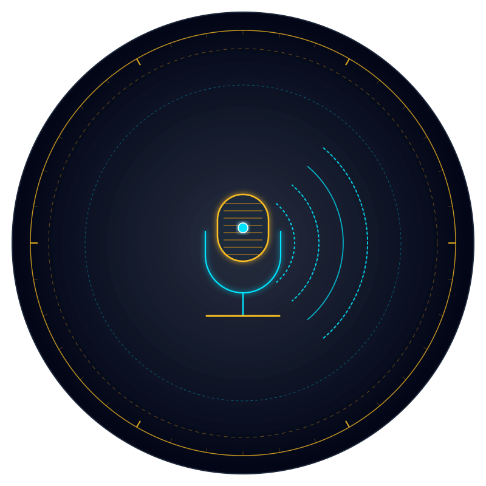

# 🎙️ Vox (`vox-dist`) — Official Distribution & Verification Hub

> **Sovereign Push-to-Talk Tactical Bridge, Real-Time Radar & Ephemeral Comms Suite**  
> *Zero cloud dependencies • Pure safe Rust • Musl static standalone binary • 100% Adversarial TDD Tested*

[](https://github.com/rmediatech/vox-dist/releases/tag/v0.3.0)
[](https://rmediatech.com/downloads)
[-brightgreen.svg)](#)
[](#)
[](https://rmediatech.com/downloads)
[-blueviolet.svg)](SOVEREIGN_RELEASE_KEY.asc)
[](https://rmediatech.com)
[](LICENSE)

<p align="center">
  
</p>

---

## 🏛️ Overview

**Vox** is an enterprise-grade, zero-cloud tactical push-to-talk communications suite and real-time audio hub written in 100% safe Rust. Designed for lone operators, tactical responders, and privacy-conscious teams, Vox delivers instant sub-millisecond voice dispatch, ephemeral throwaway burner rooms, and zero digital footprints.

### Core Capabilities
* **Tactical Push-to-Talk (PTT)**: Hardware hotkey triggering with a smooth 150ms audio release tail and authentic Nextel-style audio cues.
* **Authoritative Ephemeral Burner Rooms**: 1-click throwaway rooms that exist strictly in volatile memory and automatically purge upon vacancy with zero database traces.
* **Flight-Recorder Telemetry HUD**: Real-time pilot-grade packet health telemetry with cryptographic SHA-256 session receipts compatible with `sovereign-ledger`.
* **Laser-Pointer Telestrator**: Interactive real-time cursor trails streamed over WebRTC DataChannels, allowing peers to collaboratively highlight and draw without screen-share lag.
* **Single Standalone Static Binary & Android APK**: Pure Musl static executable for servers/workstations, paired with a companion zero-cloud Android app.

---

## 📦 Binary Verification & Download

Verified standalone binaries and Android APKs are distributed directly through the **[RMediaTech Sovereign Binary Vault](https://rmediatech.com/downloads)**:

| Platform | Target | Type | Vault Download |
| :--- | :--- | :--- | :--- |
| **Linux (Static Musl)** | `x86_64` | Standalone Binary | [Download](https://rmediatech.com/bin/vox) |
| **Android (APK)** | Universal | Mobile App | [Download APK](https://rmediatech.com/downloads) |

### 1-Click Stream Download & Installation
```bash
# 1-Click Stream Install
curl -sSL https://rmediatech.com/install/vox | sh

# Or Direct Binary Download
curl -sSL https://rmediatech.com/bin/vox -o vox
chmod +x vox
```

### Cryptographic Provenance Verification (`SOVEREIGN-SIGN-01`)
All releases are cryptographically sealed by `Rick Walker (Sovereign Release Signing Key) <rick@rmediatech.com>` (Key ID: `4E428019A109578B`):

```bash
# Import Public Key
curl -sSL https://rmediatech.com/SOVEREIGN_RELEASE_KEY.asc | gpg --import

# Verify Detached OpenPGP Signature
curl -sSL https://rmediatech.com/signatures/vox -o vox.asc
gpg --verify vox.asc vox
```

---

## 🚀 Quickstart

```bash
# Start standalone Vox communications hub
vox serve --port 8080

# Join ephemeral tactical channel
vox join --channel tactical-alpha

# Run self-check audit
vox check
```

---

## 🛡️ License & Provenance

Dual-licensed under MIT OR Apache-2.0. Cryptographically sealed by Rick Walker (`4E428019A109578B`).
